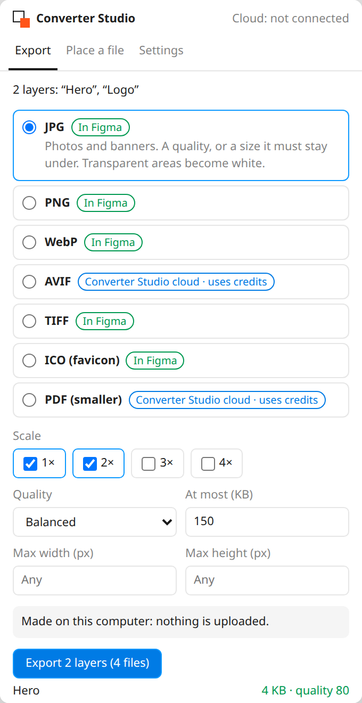
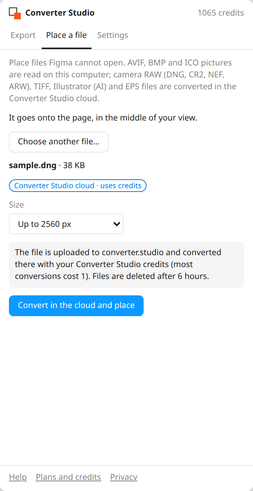

# Converter Studio for Figma

A Figma plugin by [Converter Studio](https://converter.studio) that exports layers as small
files for the web and to the formats Figma does not write, and places the files Figma cannot
open. **JPG and PNG under a size you set, WebP, TIFF and ICO favicons are made on your
computer**, inside the plugin, with no account and nothing uploaded. **AVIF, a smaller PDF, and
camera RAW, TIFF, Illustrator or EPS files** are converted in the Converter Studio cloud, only
when you choose it, with your Converter Studio account's credits.



## What it does

**Export.** Select up to 20 layers, frames or components, pick a format and press **Export**.
One file is saved as it is; several go into one ZIP. Each format says where it is made:

| Format        | Where                                 | Settings                                                                       |
| ------------- | ------------------------------------- | ------------------------------------------------------------------------------ |
| JPG           | In Figma (your computer)              | scales, quality, "at most … KB", max width and height                          |
| PNG           | In Figma                              | scales, "at most … KB", max width and height, fewer colours (lossy) if allowed |
| WebP          | In Figma                              | scales, quality, "at most … KB", max width and height                          |
| TIFF          | In Figma                              | scales; lossless, with transparency                                            |
| ICO (favicon) | In Figma                              | 16, 32 and 48 px in one file (each drawn by Figma), or one size up to 256 px   |
| AVIF          | Converter Studio cloud (uses credits) | scale, quality, "at most … KB", max width and height                           |
| PDF (smaller) | Converter Studio cloud (uses credits) | Figma's PDF with its pictures compressed: light, balanced or strong            |

- **At most … KB** (1 KB = 1000 bytes). JPG and WebP take the highest quality that stays under
  it. PNG stays lossless when that fits; otherwise, only if you tick **Fewer colours (lossy)**,
  it uses a palette with as many colours as fit (with the box ticked and no size, 256 colours).
  When a size cannot be reached (a large photo under 5 KB), the smallest file is saved anyway;
  its row says "over … KB" and the panel says what would help.
- **PNG without a size** is lossless: every visible pixel as Figma drew it, and usually smaller
  than Figma's own PNG (the plugin keeps whichever is smaller).
- **Scales**: tick 1×, 2×, 3× and 4× (Figma's own choices); with several, each layer is saved at
  each scale and named as Figma names them: `Hero.png`, `Hero@2x.png`, `Hero@3x.png`.
- **Max width and height** (in pixels): Figma draws the layer at exactly that width or height
  when the scale would make it larger, never larger than the scale.
- **JPG has no transparency**: transparent areas become white.
- **The last settings come back** the next time you open the plugin (kept by Figma for this
  plugin on this computer), so the same hand-off is: select the layers, press Export.

If something cannot be made on your computer (a layer too large for the browser, or WebP in
Figma on Safari, which writes no WebP), the plugin says why and offers **Try in the cloud (uses
credits)** where the cloud makes that format (all but PNG). It never sends anything to the cloud
on its own.

**Place a file.** Choose a file Figma cannot open. AVIF, BMP and ICO pictures are read on your
computer and placed as an image layer. Camera RAW (DNG, CR2, NEF, ARW) and TIFF files become a
PNG image layer (up to 2560 px by default, or up to 4096 px, Figma's largest), and Illustrator
(AI) or EPS files become editable vector layers (or a PNG), in the Converter Studio cloud. The
layer goes into the selected frame, scaled down to fit and centred, or onto the page in the
middle of your view, as one undo step. PNG, JPG, GIF, WebP, HEIC and SVG files are left to Figma:
drag them onto the canvas.



## Install and set up

1. In Figma, open **Plugins** (or **Resources**, Shift + I), search for **Converter Studio** and
   run it. The plugin works in Figma Design.
2. The JPG, PNG, WebP, TIFF and ICO exports and the AVIF, BMP and ICO pictures work right away.
3. For the cloud, create a Converter Studio account (free accounts get 25 credits a day; most
   conversions cost 1 credit) and an API key on your
   [account page](https://converter.studio/account#api-keys). In the plugin, open **Settings**,
   paste the key and press **Connect**: the plugin checks it with Converter Studio and shows your
   credits. Conversions up to 3 credits start on their own; dearer ones show the price and ask.

Plans and prices: [converter.studio/pricing](https://converter.studio/pricing).

## Limits

- Up to 20 layers per export (each at up to four scales), converted one after the other; keep
  the plugin open until it finishes. Very large layers (over 16,384 px a side or about 120
  million pixels at the chosen scale) cannot be made on your computer; the cloud can make them
  when you ask (except PNG, which is made on your computer only).
- PNG's fewer colours have no dithering (flat design colours stay flat); on a photo, a size
  that needs very few colours shows bands. JPG or WebP suit photos better.
- Figma takes pictures up to 4096 px a side; larger ones are made smaller before they are placed.
- What is made on your computer depends on the browser Figma runs in. The desktop app, Chrome,
  Edge and Firefox write WebP; where the browser cannot (Safari), the plugin offers WebP in the
  cloud instead. Firefox saves a WebP file and also opens it in a new tab.
- No CMYK PDF: Converter Studio does not convert colours to CMYK. PSD files and HEIC photos are
  not converted (Figma places HEIC itself).
- File sizes follow your Converter Studio plan. The panel is in English.

## Privacy and security

- **On your computer:** JPG, PNG, WebP, TIFF and ICO exports, and the AVIF, BMP and ICO pictures
  you place, are made inside the plugin from Figma's own export. Nothing is uploaded.
- **The last export settings** (format, scales, quality, size limits) are kept by Figma for this
  plugin on this computer (`figma.clientStorage`); nothing from your files is in them.
- **In the cloud, only when you choose it:** Figma's PNG (or PDF) of each layer you export to
  AVIF or a smaller PDF, or the file you choose to place, is uploaded to Converter Studio
  (converter.studio) with the settings you picked, converted, and fetched back into the plugin.
  Converter Studio deletes the files after 6 hours. See the
  [privacy policy](https://converter.studio/privacy). Nothing else from your Figma file is read
  or sent.
- **The API key** is kept by Figma for this plugin on this computer (`figma.clientStorage`): not
  in your Figma files, and not visible to anyone you share them with. It is sent only to
  Converter Studio's API. **Disconnect** deletes it; you can also delete the key on your account
  page at any time.
- **Network access:** the manifest allows only `https://converter.studio/api/` (Figma shows it as
  "Restricted network access"). Requests carry no cookies, and the key is never logged.
- The plugin asks Figma for no extra permissions (no current user, no team library, no payments).

## How it is built

| Path                     | What                                                                                              |
| ------------------------ | ------------------------------------------------------------------------------------------------- |
| `public/manifest.json`   | The plugin's manifest: Figma Design, `dynamic-page`, network access to the Converter Studio API   |
| `src/code/`              | `code.js`: runs in Figma's sandbox with the `figma` API; exports layers, places pictures and SVGs |
| `src/ui/`                | The panel (`ui.html`): the export and place flows, the API client, the panel itself               |
| `src/ui/encode/`         | Our own small PNG, TIFF, ICO and ZIP writers, and PNG's fewer colours (with image-q)              |
| `src/ui/fit.ts`          | "At most … KB": the best quality or palette under the size                                        |
| `src/shared/messages.ts` | The messages between the two, checked on arrival on both sides                                    |
| `build.mjs`              | Builds `dist/` (`manifest.json`, `code.js`, `ui.html`) and checks it                              |
| `test/`                  | Unit tests with a stand-in Figma API, browser canvas and Converter Studio API                     |

Plain TypeScript and DOM, no framework. The code is bundled with esbuild and not minified.
`code.js` is type-checked without the DOM's types (Figma's sandbox has none) against Figma's
official `@figma/plugin-typings`.

**Third-party code.** One library, in the panel only, for PNG's fewer colours:
[image-q](https://github.com/ibezkrovnyi/image-quantization) 4.0.0 (MIT; it includes
NeuQuant's and RgbQuant's permissive notices), from npm, unmodified (`dist/esm/image-q.mjs`).
The build checks the file's SHA-256 against the published release and writes the library's
licence at the top of the panel's script. JPG and WebP are the browser's own encoders; PNG, TIFF,
ICO and ZIP are our own code.

```sh
npm ci              # Node 22.13 or later
npm test            # unit tests (Vitest; the panel's in jsdom): no network
npm run typecheck
npm run build       # dist/: manifest.json, code.js, ui.html
node build.mjs --api http://localhost:8080/api
                    # a development build against another Converter Studio API
```

To run your build: Figma desktop app → **Plugins → Development → Import plugin from
manifest…** → `dist/manifest.json`.

## Support

Questions and problems: support@converter.studio or
[GitHub issues](https://github.com/tariksucu/figma-converter-studio/issues).
More about the API: [converter.studio/developers](https://converter.studio/developers).

## License

MIT, © Converter Studio.
